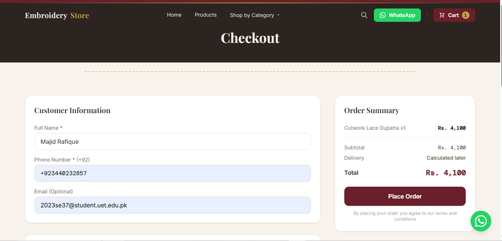

# 🧵 Embroidery Store — E-Commerce Website

A complete full-stack e-commerce platform built for a handmade embroidery business in Lahore, Pakistan. Customers can browse products, place orders via Cash on Delivery or mobile payments, track their orders, and leave reviews — while the store owner manages everything through a dedicated admin panel.

**🔗 Live Website:** [embroidery-store-tau.vercel.app](https://embroidery-store-tau.vercel.app/)

---
## 📸 Screenshots

### Homepage


### Products Page


### Product Detail Page


### Shopping Cart


### Checkout


### Admin Dashboard


### Admin Orders


### Admin Reviews

---

## ✨ Features

### Customer-Facing Website
- 🏠 Homepage with hero slider, best sellers, new arrivals, and customer testimonials
- 🔍 Live product search with instant results
- 🗂️ Category browsing (Zari Work, Thread Embroidery, Mirror Work, Cutwork & Lace)
- 🛒 Full shopping cart with quantity management
- 💳 Checkout with Cash on Delivery, JazzCash, and Easypaisa
- 📦 Order tracking by Order ID
- ⭐ Customer reviews and ratings on every product
- 💬 WhatsApp integration for support and custom orders
- 📱 Fully responsive — mobile, tablet, and desktop
- 📄 FAQs, Shipping Policy, Return Policy, About Us, and Contact pages

### Admin Panel
- 🔐 Secure login with JWT authentication
- 📊 Dashboard with order stats, revenue, and low-stock alerts
- 🧵 Full product management — add, edit, delete products
- 📦 Order management with status updates (Pending → Confirmed → Shipped → Delivered)
- ⭐ Review moderation — approve or remove customer reviews

---

## 🛠️ Tech Stack

**Frontend:**
- React.js + Vite
- React Router
- Tailwind CSS

**Backend:**
- Node.js + Express
- MongoDB (Mongoose)
- JWT Authentication + bcrypt

**Deployment:**
- Frontend — Vercel
- Backend — Railway
- Database — MongoDB Atlas

---

## 📁 Project Structure
src/
├── components/ → Reusable UI components (Navbar, Footer, ProductCard...)
├── pages/ → Page components (Home, Products, Cart, Checkout...)
├── pages/admin/ → Admin panel pages
├── context/ → Cart state management
├── data/ → Static reference data
├── services/ → API service layer
└── utils/ → Helper functions


---

## 🚀 Getting Started (Local Development)

```bash
# Clone the repository
git clone https://github.com/majidawan01/embroidery-store.git

# Install dependencies
npm install

# Run development server
npm run dev
```

The app will run at `http://localhost:5173`. Note: this frontend connects to a separate backend repository ([embroidery-backend](https://github.com/majidawan01/embroidery-backend)) which must be running for full functionality.

---

## 📞 Contact

For business inquiries related to this project, reach out via WhatsApp at **+92 344 0232857**.

---

*This project was built as a complete e-commerce solution — from frontend design to backend API, database, admin panel, and live deployment.*
